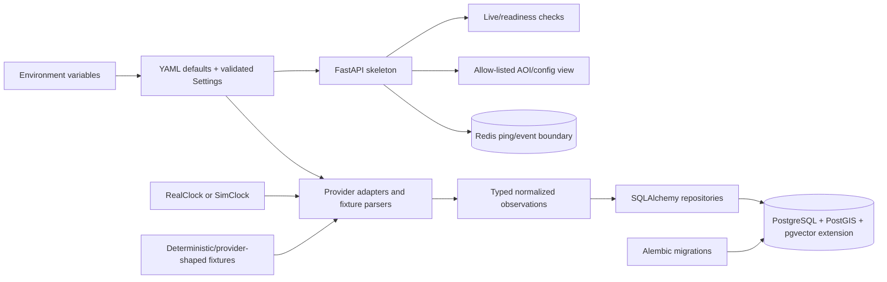

# Phase 1: Foundations and Data Contracts - Research

**Researched:** 2026-10-01
**Domain:** Python monorepo foundation, typed geospatial contracts, PostgreSQL/PostGIS/pgvector, Redis, FastAPI, offline provider fixtures
**Confidence:** MEDIUM

<user_constraints>
## User Constraints (from CONTEXT.md)

### Locked Decisions
- **D-01:** `docker compose up` must start healthy PostGIS/pgvector and Redis plus a minimal FastAPI API skeleton.
- **D-02:** The API skeleton should expose health/readiness and safe non-secret configuration/AOI introspection; full monitoring endpoints belong to later phases.
- **D-03:** Use hybrid testing: pure unit tests for domain/config/schema logic and a small Compose-backed smoke suite for service connectivity and migrations.
- **D-04:** Configuration uses YAML defaults with environment-variable overrides, matching the supplied EnvSetup and Rules documents.
- **D-05:** Use the supplied bbox as the default AOI input: west 76.0, south 11.5, east 77.3, north 12.4.
- **D-06:** Represent the AOI as configurable geometry with a replaceable placeholder polygon; authoritative park polygons remain a pending decision.
- **D-07:** Seed Bandipur as the provisional pilot settlement cluster, with a configurable cluster identifier so the Phase 2 pilot decision can replace it without a contract rewrite.
- **D-08:** Include both small deterministic domain fixtures and provider-shaped FIRMS/Open-Meteo samples with raw payloads for parser and contract tests.
- **D-09:** No live external API calls are required for Phase 1 or CI. Live FIRMS/weather verification may be added later as an explicit opt-in command.

### Claude's Discretion
- Exact package/module boundaries within the supplied FolderStructure.
- Exact migration split within the Phase 1 monitoring/shared-state tables, provided later schema compatibility is preserved.
- Exact health endpoint response field names, provided secrets are excluded and dependency status is observable.

### Deferred Ideas (OUT OF SCOPE)
- Final park-boundary AOI and final pilot settlement selection - resolve during Phase 2/G0 decision work.
- Live FIRMS/Open-Meteo validation in CI - keep opt-in and outside the offline foundation gate.
- Full monitoring endpoints, coordinator behavior, route planning, shelter matching, human review/dissemination, and dashboard - covered by later roadmap phases.
</user_constraints>

<phase_requirements>
## Phase Requirements

| ID | Description | Research Support |
|----|-------------|------------------|
| MON-01 | Poll and de-duplicate FIRMS data for a configurable AOI | Provider-shaped CSV parser, normalized `HotspotObservation`, uniqueness key, origin/freshness fields |
| MON-02 | Poll weather and record provider/freshness metadata | Open-Meteo fixture parser, `WeatherObservation`, issued/valid timestamps and provider metadata |
| MON-03 | Persist monitoring data and open/update incidents at thresholds | Phase 1 Alembic boundary for observations, incidents, clusters, triggers, and shared snapshots |
| MON-04 | Surface stale/unavailable data and avoid silent action | Freshness contract, readiness/degraded status separation, explicit fixture origin and parser errors |
| FIRE-01 | Prepare seeded fire-model inputs | Stable hotspot/weather/AOI contracts, injected clock, explicit seed in run parameters |
| FIRE-02 | Prepare forecast/risk output contracts | Typed perimeter/risk shapes with provenance and freshness reserved for Phase 2 implementation |
</phase_requirements>

## Summary

Phase 1 should be a small vertical foundation, not a premature implementation of the whole Schema.md. Build one shared `wildfire_core` package, one minimal FastAPI process, one Compose database/cache stack, and one Alembic lineage. The first migration should install `postgis`, `vector`, and `pgcrypto`, then create only the AOI, monitoring, incident/trigger, and shared-state/audit primitives needed by Phase 1. Later plan/review/dissemination tables can extend the same enums and foreign-key graph without changing the public Pydantic contracts. [VERIFIED: generatedPlan/FolderStructure.md, generatedPlan/Schema.md, generatedPlan/TechSpec.md]

Use Pydantic v2 models as the boundary for normalized observations, health responses, configuration introspection, shared state, and future agent tools. Keep provider payloads as opaque raw data alongside normalized fields, and carry `origin`, `provider`, `issued_at`, `valid_time`, and freshness status explicitly. A UTC-aware injected `Clock` plus explicit simulation seed makes fixture parsing and future replay deterministic. [CITED: https://fastapi.tiangolo.com/tutorial/body/; https://pydantic.dev/docs/validation/latest/concepts/pydantic_settings/; generatedPlan/Rules.md]

**Primary recommendation:** implement a pinned, offline-first foundation around Python 3.11/3.12, FastAPI, Pydantic v2, pydantic-settings, SQLAlchemy 2, Alembic, psycopg 3, redis-py, PyYAML, Shapely, and Hypothesis; make Compose health checks and migration smoke tests the only service-level gate.

## Architectural Responsibility Map

| Capability | Primary Tier | Secondary Tier | Rationale |
|------------|-------------|----------------|-----------|
| YAML and environment configuration | API / Backend | — | One validated settings object must be shared by API, worker, and tests; env values override file defaults. |
| AOI geometry and coordinate validation | API / Backend | Database / Storage | Pydantic/Shapely validate input; PostGIS stores indexed geometry. |
| FIRMS/Open-Meteo normalization | API / Backend | Database / Storage | Provider adapters own external shapes; repositories persist normalized records and raw payloads. |
| Shared state and freshness metadata | Database / Storage | Redis | Postgres is durable/versioned truth; Redis is hot state/event transport, matching the source architecture. |
| Health/readiness | Frontend Server/API | Database / Storage | FastAPI exposes liveness without dependencies and readiness with observable DB/Redis checks. |
| Deterministic time and fixture replay | API / Backend | — | Domain code uses `Clock`; tests use a fixed simulated implementation. |
| Migrations and extension setup | Database / Storage | — | Alembic is the schema authority; Compose only supplies the service and extension-capable image. |

## Project Constraints (from copilot-instructions.md)

No workspace `copilot-instructions.md` exists at the project root. The applicable constraints were read from `generatedPlan/Rules.md` and the planning state:

- Treat the product as decision support; human approval remains structural and no auto-approval path may be introduced. [VERIFIED: generatedPlan/Rules.md]
- Numeric and safety-critical logic must be deterministic; LLMs must not compute geometry, routes, capacity, dispatch, or invent entities. [VERIFIED: generatedPlan/Rules.md]
- Carry simulation/origin labels and freshness; keep audit records append-only and secrets out of source and logs. [VERIFIED: generatedPlan/Rules.md]
- Use full Python type hints, Pydantic v2 I/O models, explicit CRS/SI units, injected dependencies, UTC `Clock`, and no `datetime.now()` in domain code. [VERIFIED: generatedPlan/Rules.md]
- Schema changes go through Alembic; every geometry column gets a GiST index; data downloads stay out of git; small fixtures stay below 1 MB. [VERIFIED: generatedPlan/Rules.md]
- Configuration is YAML defaults followed by environment overrides; no threshold or interval magic numbers in code. [VERIFIED: generatedPlan/Rules.md]
- CI uses mock providers/simulated clock and no live external calls. [VERIFIED: generatedPlan/Rules.md]

## Standard Stack

### Core

| Library / service | Version guidance | Purpose | Why standard |
|---|---:|---|---|
| Python | 3.11 or 3.12 | Runtime | Matches the project requirement and geospatial wheel support. The current host is Python 3.10, so do not use it as the acceptance runtime. [VERIFIED: generatedPlan/EnvSetup.md; environment probe] |
| FastAPI | 0.142.2 reported by PyPI on 2026-10-01 | Minimal API and OpenAPI | Typed Pydantic request/response models and straightforward liveness/readiness routes. [ASSUMED: registry result; official docs page was not extractable] |
| Pydantic | 2.13.5 reported by PyPI on 2026-10-01 | Domain and API contracts | Validation and JSON schema generation. [ASSUMED: registry result; legitimacy gate flagged SUS] |
| pydantic-settings | 2.15.0 reported by PyPI on 2026-10-01 | YAML/env settings source | Official docs describe validated `BaseSettings`, env precedence, aliases, nested values, and YAML sources. [CITED: https://pydantic.dev/docs/validation/latest/concepts/pydantic_settings/] |
| SQLAlchemy | 2.0.54 reported by PyPI on 2026-10-01 | Typed persistence/session layer | SQLAlchemy 2 async engine and explicit transaction boundaries fit FastAPI I/O. [ASSUMED: registry result; legitimacy gate flagged SUS] |
| Alembic | 1.20.0 reported by PyPI on 2026-10-01 | Versioned migrations | Official cookbook documents async migration via `run_sync`, transactional DDL, and separate data migration concerns. [CITED: https://alembic.sqlalchemy.org/en/latest/cookbook.html] |
| psycopg | 3.3.6 reported by PyPI on 2026-10-01 | PostgreSQL driver | Use the async-capable SQLAlchemy URL form `postgresql+psycopg://`; keep migrations on a controlled connection. [ASSUMED: registry result; legitimacy gate flagged SUS] |
| redis | 8.1.0 reported by PyPI on 2026-10-01 | Redis health, cache, later pub/sub | Keep Redis access behind a small port/protocol in `wildfire_core`; Phase 1 needs ping/readiness only. [ASSUMED: registry result; legitimacy gate flagged SUS] |
| PostGIS | PostGIS-capable image, pin exact image digest | SRID 4326 geometry and spatial indexes | PostGIS provides geometry/geography types and GiST spatial indexes. [CITED: https://postgis.net/docs/] |
| PostgreSQL | 16 | Durable relational state | Locked by Schema.md; extension compatibility must be tested in Compose. [VERIFIED: generatedPlan/Schema.md, quote: `**DB:** PostgreSQL 16 + PostGIS + pgvector`] |
| pgvector | 0.8.6 source/image line reported by official repository | Future embedding column/index support | Install the extension now for the locked stack, but defer vector columns/indexes until embedding dimension/provider is decided. [CITED: https://github.com/pgvector/pgvector] |
| Redis server | 7 | Hot shared state and pub/sub service | Locked by EnvSetup.md and compatible with a simple ping healthcheck. [VERIFIED: generatedPlan/EnvSetup.md, quote: `image: redis:7`] |

### Supporting

| Library | Version guidance | Purpose | When to use |
|---|---:|---|---|
| PyYAML | 6.0.3 reported by PyPI | Load YAML defaults | Use only through one settings source; never let arbitrary YAML bypass Pydantic validation. [ASSUMED: registry result; legitimacy gate flagged SUS] |
| Shapely | 2.1.2 reported by PyPI | Placeholder polygon, bbox geometry, validity checks | Use for pure unit geometry validation; keep persistence CRS explicit. [ASSUMED: registry result; legitimacy gate flagged SUS] |
| Hypothesis | 6.168.3 reported by PyPI | Property tests for bbox, dedupe, freshness, and seed invariants | Add focused properties now; reserve route/capacity properties for later phases. [ASSUMED: registry result; legitimacy gate flagged SUS] |
| ruff | 0.16.9 reported by PyPI | Format/lint | Required quality tool in the source rules. [ASSUMED: registry result] |
| mypy | 2.3.1 reported by PyPI | Strict typing | Apply strict mode to `wildfire_core` and agents as required by Rules.md. [ASSUMED: registry result] |
| pytest | Pin in `pyproject.toml` after Wave 0 verification | Unit/integration runner | Hybrid unit plus Compose smoke suite. Version was not independently queried in this session. [ASSUMED] |

### Alternatives Considered

| Instead of | Could use | Tradeoff |
|---|---|---|
| SQLAlchemy + Alembic | SQLModel or handwritten SQL | Do not add a second ORM abstraction; SQLAlchemy/Alembic gives explicit migrations and later async repositories. |
| Redis client directly in feature modules | `redis` behind `wildfire_core.events` | Hide connection details now so future pub/sub and locks do not leak through contracts. |
| Separate vector database | pgvector | The source decision is one Postgres store; no Phase 1 vector queries are needed. |
| Full provider SDKs | `httpx` adapters plus fixtures | Thin HTTP adapters are easier to mock and keep provider payload parsing explicit; do not make live calls in CI. |
| Runtime-generated geometry | Shapely/PostGIS validated geometry | Avoid string-only polygons and silent axis/CRS errors. |

**Installation direction:** use `uv` workspace dependencies and a checked-in lockfile. Before installing any package, complete the package legitimacy checkpoint below; do not blindly copy the reported latest versions into implementation.

## Package Legitimacy Audit

The required `package-legitimacy check --ecosystem pypi` returned no SLOP packages, but every package checked was flagged SUS for `too-new`, `unknown-downloads`, or `no-repository` signals in this environment. This is a tooling risk signal, not proof the projects are malicious. The planner must add `checkpoint:human-verify` before dependency installation and re-run the registry/official-source checks.

| Package | Registry | Reported version | Verdict | Disposition |
|---|---|---:|---|---|
| fastapi | PyPI | 0.142.2 | SUS | Flagged; verify official repository/release before install |
| pydantic, pydantic-settings | PyPI | 2.13.5 / 2.15.0 | SUS | Flagged; verify before install |
| sqlalchemy, alembic | PyPI | 2.0.54 / 1.20.0 | SUS | Flagged; verify before install |
| psycopg, redis | PyPI | 3.3.6 / 8.1.0 | SUS | Flagged; verify before install |
| pyyaml, shapely, geopandas, hypothesis | PyPI | current registry values | SUS | Flagged; Shapely/GeoPandas/Hypothesis also lacked repo signals |
| ruff, mypy, pytest | PyPI | current/unspecified | Not fully audited | Verify before install |

**Packages removed due to SLOP verdict:** none.
**Packages flagged as suspicious [SUS]:** all packages listed above; planner inserts a human verification checkpoint before each install group.

## Architecture Patterns

### System Architecture Diagram



### Recommended Project Structure

```text
wildfire-coord/
├── config/                         # YAML defaults; no secrets
├── packages/wildfire_core/
│   └── src/wildfire_core/
│       ├── config.py               # YAML + env source and safe projection
│       ├── clock.py                # Clock, RealClock, SimClock
│       ├── schemas/                # contracts, state, provider, health
│       ├── geo/                    # bbox/polygon/CRS helpers
│       ├── db/                     # SQLAlchemy models, session, repositories
│       ├── events.py               # Redis boundary
│       └── state.py                # versioned shared-state operations
├── apps/api_gateway/src/api_gateway/
│   ├── main.py                     # app factory
│   ├── health.py                   # live/readiness probes
│   └── routers/config.py           # safe config/AOI only
├── apps/ingest_worker/src/ingest_worker/
│   ├── firms/                      # client, CSV parser, dedupe
│   └── weather/                    # Open-Meteo client/parser
├── infra/migrations/               # Alembic env.py and versions
├── infra/postgres/init.sql         # extension enablement only
├── tests/unit/                     # no Docker/network
├── tests/integration/              # Compose smoke and migration checks
└── tests/fixtures/                 # small raw + normalized fixtures
```

The structure follows the supplied FolderStructure names; agents must import only `wildfire_core` and communicate through future typed contracts. [VERIFIED: generatedPlan/FolderStructure.md, quote: `Services import wildfire_core; agents never import each other.`]

### Pattern 1: Settings source pipeline

**What:** Load `config/*.yaml` as low-priority defaults, then apply environment variables with Pydantic validation. Keep secrets as `SecretStr` and project only non-secret fields to the introspection endpoint. [CITED: https://pydantic.dev/docs/validation/latest/concepts/pydantic_settings/]

**When to use:** Every API/worker/test process. Construct settings once at the process boundary; pass the typed settings object into dependencies. In async startup, file-backed settings loading should occur before serving or in a worker thread because settings sources are synchronous. [CITED: https://pydantic.dev/docs/validation/latest/concepts/pydantic_settings/]

**Important implementation detail:** Pydantic settings treats complex environment values as JSON by default. Therefore model `AOI_BBOX` as a dedicated comma-separated parser (or a custom settings source) and test malformed, reversed, out-of-range, and extra-coordinate values. Do not assume a string `76.0,11.5,77.3,12.4` will become a tuple automatically. [CITED: https://pydantic.dev/docs/validation/latest/concepts/pydantic_settings/]

### Pattern 2: Explicit contract envelope

Use one provider-neutral envelope for all normalized observations:

```python
class ObservationMeta(BaseModel):
    provider: str
    origin: Literal["live", "replay", "simulated", "manual"]
    observed_at: datetime
    issued_at: datetime | None = None
    valid_time: datetime | None = None
    ingested_at: datetime
    freshness: Freshness
    raw_payload_ref: str | None = None
```

Then define `FirmsHotspot`, `WeatherObservation`, and later `FireRun`/`RiskAssessment` as typed models containing the envelope. Keep raw provider fields in a provider-specific model or JSON column, never mixed into the normalized safety contract. All datetimes must be timezone-aware UTC; all coordinates are `(lon, lat)` in EPSG:4326. [VERIFIED: generatedPlan/Schema.md, quote: `All geometries use **SRID 4326** (lon/lat)` and `All timestamps are `timestamptz` in UTC.`; generatedPlan/Rules.md]

Use `extra="forbid"` on normalized/domain models so contract drift fails tests. Use a separate raw payload type with `dict[str, Any]` only at the provider boundary. Add a `schema_version` field to tool/event envelopes from the start; it permits additive evolution without rewriting later agent contracts. [VERIFIED: generatedPlan/Rules.md, quote: `Typed tool contracts. Every tool has Pydantic input/output models, versioned in packages/core.`]

### Pattern 3: Clock and deterministic identity

Define a small protocol with `now_utc() -> datetime` and, if needed, `monotonic() -> float`. `RealClock` delegates to the platform clock only in infrastructure edges; `SimClock` stores a timezone-aware instant and advances only when the scenario/test asks. Domain services receive `Clock` by constructor/dependency injection. [VERIFIED: generatedPlan/TechSpec.md, quote: `Clock abstraction: all time-dependent code uses Clock (real or simulated).`; generatedPlan/Rules.md]

Do not use wall-clock time for dedupe, freshness, or fixture assertions. Use the injected clock for `ingested_at`, incident trigger timestamps, and freshness age. Generate UUIDs at the persistence edge; fixed fixtures should use stable UUID literals or a deterministic UUID5 namespace, never random IDs. Record the fire seed explicitly even before the Phase 2 simulator exists. [VERIFIED: generatedPlan/Rules.md, quote: `Same inputs + seed → same output. Pass seeds explicitly; record them in fire_runs.params.`]

### Pattern 4: Compose readiness and migration smoke

Compose does not wait for a container to be ready merely because it is running. Add healthchecks to Postgres and Redis and use `depends_on.condition: service_healthy` for the API. The API liveness route must not require dependencies; readiness must execute bounded DB and Redis checks and return a structured status per dependency. [CITED: https://docs.docker.com/compose/how-tos/startup-order/]

The smoke suite should start Compose, wait for health, run `alembic upgrade head`, query `SELECT PostGIS_Version()` and `SELECT extversion FROM pg_extension WHERE extname = 'vector'`, ping Redis, call `/api/v1/health/live` and `/api/v1/health/ready`, and tear down. It should not call FIRMS, Open-Meteo, OSM, map tiles, or an LLM.

### Pattern 5: Forward-compatible migration layering

Use these Phase 1 revisions:

1. `0001_extensions_and_aoi`: `postgis`, `vector`, `pgcrypto`, `areas_of_interest`, geometry indexes, and the placeholder AOI seed only if seed data is explicitly separated from schema.
2. `0002_monitoring`: `hotspots`, `weather_observations`, `settlements`, and their uniqueness/GiST indexes.
3. `0003_incidents_and_triggers`: `incidents`, `hotspot_clusters`, `triggers`, required foreign keys, and indexes.
4. `0004_shared_state_audit`: `shared_state_snapshots`, `agent_runs`, `agent_messages`, and `audit_log` append-only foundations.

Keep data seeding out of irreversible schema revisions where possible. Alembic's cookbook distinguishes schema migrations from data migrations and documents async migration through a synchronous `run_sync` bridge. [CITED: https://alembic.sqlalchemy.org/en/latest/cookbook.html]

Do not create Phase 1 vector columns or HNSW indexes with an arbitrary `vector(1024)` merely because Schema.md shows that draft. pgvector supports multiple dimensions and index behavior depends on the chosen distance/dimension; defer the embedding contract until the provider/model decision is made. [CITED: https://github.com/pgvector/pgvector]

## Don't Hand-Roll

| Problem | Don't build | Use instead | Why |
|---|---|---|---|
| Contract validation/schema | Manual dict checks | Pydantic v2 models | OpenAPI/schema generation and consistent validation at every boundary. |
| Migration tracking | `create_all()` on API startup | Alembic revisions | Reproducible upgrades/downgrades and reviewable schema history. |
| Spatial predicates/indexing | Haversine/string geometry helpers for persistence | PostGIS geometry/geography plus Shapely for pure functions | CRS, validity, and GiST behavior have many edge cases. |
| YAML/env precedence | Ad hoc `os.getenv` calls throughout modules | One typed settings source | Prevents inconsistent defaults and accidental secret exposure. |
| Time in domain code | Patching `datetime.now()` in tests | Injected `Clock`/`SimClock` | Replay and freshness assertions remain deterministic. |
| Redis lifecycle | Feature modules opening clients directly | One Redis dependency provider | Centralizes timeouts, ping, close, and future pub/sub. |
| Provider parsing | Passing raw payloads across the system | Provider adapter + normalized contract + raw retention | Provider fields change; domain contracts should not. |
| Deduplication | In-memory set only | Database unique constraint plus idempotent repository upsert | Survives restarts and concurrent ingest. |

**Key insight:** Phase 1's safety value is traceability, not model sophistication. The most dangerous shortcut is allowing raw provider payloads, implicit local time, or unvalidated geometry to cross into shared state.

## Runtime State Inventory

This is a foundations phase, not a rename/refactor/migration of an existing application. No application runtime state exists because the repository has no source, database, services, or build artifacts. [VERIFIED: .planning/phases/01-foundations-and-data-contracts/01-CONTEXT.md, quote: `No application source exists. The generatedPlan documents are the only reusable project assets.`]

| Category | Items Found | Action Required |
|---|---|---|
| Stored data | None; no database or records found | Create schema via Alembic; no data migration |
| Live service config | None found | Create local Compose config; no external service migration |
| OS-registered state | None found | None |
| Secrets/env vars | No project `.env` exists in source; only documented placeholders | Create `.env.example`; never commit `.env` or real keys |
| Build artifacts / installed packages | No project build artifacts; host has Python 3.10 and tools | Use project-managed Python 3.11/3.12 via `uv`/containers; do not treat host packages as project state |

## Common Pitfalls

### Pitfall 1: PostGIS/pgvector image mismatch
**What goes wrong:** A PostGIS image may not contain pgvector, while the official pgvector image is not automatically a PostGIS image. `CREATE EXTENSION vector` then fails at migration time.
**Why it happens:** Extension SQL only works when the server has the extension control files installed; PostgreSQL documents that `CREATE EXTENSION` loads those installed files. [CITED: https://www.postgresql.org/docs/current/sql-createextension.html]
**How to avoid:** Pin a custom image built from the chosen PostGIS/PostgreSQL 16 base with pgvector 0.8.6 compiled/installed, or verify a single maintained image contains both. Test both `postgis` and `vector` extension creation in a clean volume.
**Warning signs:** Compose is healthy but `alembic upgrade head` fails with `extension "vector" is not available`.

### Pitfall 2: Health means process-running, not dependency-ready
**What goes wrong:** API starts before Postgres accepts connections and reports a misleading healthy state.
**How to avoid:** separate `/health/live` and `/health/ready`; healthcheck Postgres with `pg_isready`, Redis with `redis-cli ping`, and gate API startup on healthy dependencies. [CITED: https://docs.docker.com/compose/how-tos/startup-order/]

### Pitfall 3: YAML/env override silently fails
**What goes wrong:** A typo such as `AOI_BBOX` with the wrong nested spelling is ignored and the default remains active.
**How to avoid:** use explicit aliases/custom parsing, test every documented override, expose only the resolved non-secret projection, and fail on malformed recognized values. Pydantic settings documents that unknown environment names can be ignored. [CITED: https://pydantic.dev/docs/validation/latest/concepts/pydantic_settings/]

### Pitfall 4: Coordinate order and metric math drift
**What goes wrong:** latitude/longitude are swapped, or degree distances are used as meters.
**How to avoid:** centralize `BBox(west, south, east, north)`, enforce `west < east` and `south < north`, serialize GeoJSON as `(lon, lat)`, store EPSG:4326, and reserve metric work for PostGIS geography or projected EPSG:32643. [VERIFIED: generatedPlan/Rules.md, quote: `Axis order **(lon, lat)** in GeoJSON and Shapely.`]

### Pitfall 5: Raw provider shape becomes the domain contract
**What goes wrong:** a FIRMS column name or Open-Meteo array shape leaks into future agents and breaks when the provider changes.
**How to avoid:** keep raw payload fixtures and parser-specific models at the adapter boundary, then emit normalized contracts with explicit metadata.

### Pitfall 6: Nondeterministic timestamps/IDs break replay
**What goes wrong:** fixture output differs because ingestion uses wall clock or random UUIDs.
**How to avoid:** inject `SimClock`, use fixed fixture IDs, and compare normalized outputs rather than raw serialization ordering.

### Pitfall 7: Initial migration overcommits future decisions
**What goes wrong:** Phase 1 locks final park boundaries, settlement selection, embedding dimensions, or full plan/review tables before the decisions are made.
**How to avoid:** seed a replaceable placeholder polygon and configurable `pilot_cluster_id`; keep plan/review/vector details additive and document the boundary in migration comments/ADR.

### Pitfall 8: Readiness endpoint leaks secrets
**What goes wrong:** configuration introspection returns DSNs, passwords, API keys, or full environment dumps.
**How to avoid:** create an explicit allow-list response containing `app_env`, AOI bbox/polygon summary, pilot cluster id, provider names, and `llm_enabled`; never serialize the settings object wholesale.

## Code Examples

### Bbox and freshness contract

```python
from datetime import datetime
from typing import Literal
from pydantic import BaseModel, Field, model_validator


class BBox(BaseModel):
    west: float = Field(ge=-180, le=180)
    south: float = Field(ge=-90, le=90)
    east: float = Field(ge=-180, le=180)
    north: float = Field(ge=-90, le=90)

    @model_validator(mode="after")
    def ordered(self) -> "BBox":
        if self.west >= self.east or self.south >= self.north:
            raise ValueError("bbox bounds must be ordered")
        return self


class Freshness(BaseModel):
    as_of: datetime
    age_seconds: int = Field(ge=0)
    status: Literal["fresh", "stale", "unavailable"]
```

This shape reflects the locked bbox values `west=76.0, south=11.5, east=77.3, north=12.4` and the source requirement for explicit freshness. [VERIFIED: .planning/phases/01-foundations-and-data-contracts/01-CONTEXT.md, quote: `west 76.0, south 11.5, east 77.3, north 12.4`; generatedPlan/API.md]

### Clock protocol

```python
from datetime import datetime, timezone
from typing import Protocol


class Clock(Protocol):
    def now_utc(self) -> datetime: ...


class RealClock:
    def now_utc(self) -> datetime:
        return datetime.now(timezone.utc)
```

Keep `RealClock` at the infrastructure edge and use `SimClock` in tests/replay. The source explicitly requires real/simulated clock injection. [VERIFIED: generatedPlan/TechSpec.md; generatedPlan/Rules.md]

### Safe readiness shape

```python
class DependencyStatus(BaseModel):
    status: Literal["ok", "unavailable"]
    detail: str | None = None


class ReadinessResponse(BaseModel):
    status: Literal["ready", "not_ready"]
    dependencies: dict[str, DependencyStatus]
```

Do not include URLs, credentials, exception tracebacks, or arbitrary config values in this response. The exact field names are discretionary, but dependency status must be observable under D-02.

### Provider fixture layout

```text
tests/fixtures/
├── firms/
│   ├── hotspot_sample.csv          # exact provider-shaped columns
│   ├── hotspot_expected.json       # normalized model projection
│   └── hotspot_duplicate.csv       # duplicate-key case
└── open_meteo/
    ├── forecast_sample.json        # exact provider-shaped hourly arrays
    └── forecast_expected.json      # normalized hourly observations
```

Fixtures should include a raw payload, expected normalized model, fixed timestamps, fixed coordinates inside the placeholder AOI, and `origin="replay"` or `origin="simulated"`; no fixture should require a secret or network. [VERIFIED: .planning/phases/01-foundations-and-data-contracts/01-CONTEXT.md, quote: `Include both small deterministic domain fixtures and provider-shaped FIRMS/Open-Meteo samples with raw payloads for parser and contract tests.`]

## State of the Art

| Older/fragile approach | Phase 1 approach | Impact |
|---|---|---|
| `BaseSettings` from Pydantic v1 | Separate `pydantic-settings` package with Pydantic v2 | Makes source precedence explicit and avoids mixing obsolete APIs. [CITED: https://pydantic.dev/docs/validation/latest/concepts/pydantic_settings/] |
| Compose `depends_on` without health conditions | `service_healthy` plus explicit healthchecks | Removes startup race assumptions. [CITED: https://docs.docker.com/compose/how-tos/startup-order/] |
| `create_all()` as deployment schema | Alembic revision lineage | Preserves forward migrations and reviewability. [CITED: https://alembic.sqlalchemy.org/en/latest/cookbook.html] |
| Vector index chosen before model decision | Extension installed, vector contract deferred | Avoids locking the wrong dimension/distance/index tradeoff. [CITED: https://github.com/pgvector/pgvector] |

**Deprecated/outdated:** Do not use Pydantic v1 `BaseSettings`, untyped raw dicts across agent boundaries, or network-backed tests as the Phase 1 acceptance gate. [CITED: https://pydantic.dev/docs/validation/latest/concepts/pydantic_settings/; VERIFIED: generatedPlan/Rules.md]

## Assumptions Log

| # | Claim | Section | Risk if wrong |
|---|---|---|---|
| A1 | The reported PyPI versions are suitable to pin after human verification. | Standard Stack | A future package or incompatible dependency could block bootstrap. |
| A2 | A maintained/custom PostgreSQL 16 image can bundle both PostGIS and pgvector 0.8.6. | Pitfalls/Compose | Image build or extension installation may need a different pinned combination. |
| A3 | Phase 1 should defer all vector columns/indexes even though the draft schema includes `vector(1024)`. | Migration layering | Later embedding retrieval may require an additive migration and dimension decision. |
| A4 | `pytest` should be used for the hybrid suite; its version was not queried in this session. | Validation Architecture | The implementation may choose a different runner if the team already standardizes one. |

## Open Questions

1. **Which exact PostGIS/pgvector PostgreSQL 16 image will be pinned?**
   - What we know: both extensions must be installed before `CREATE EXTENSION`; the official pgvector repository lists PostgreSQL 16 Docker tags. [CITED: https://www.postgresql.org/docs/current/sql-createextension.html; https://github.com/pgvector/pgvector]
   - What's unclear: whether the selected PostGIS base and pgvector build are compatible on the team/CI architecture.
   - Recommendation: make image verification a Wave 0 task and require a clean-volume migration smoke test on CI.
2. **Should AOI seed data live in a migration or an explicit seed command?**
   - Recommendation: keep schema migrations structural and use `scripts/seed_demo.py` for the provisional polygon/cluster so the seed can be replaced without a schema migration.
3. **What is the Phase 2 pilot settlement identifier?**
   - Recommendation: use a stable configurable identifier such as `bandipur` only as a provisional default; do not encode it into table names or contract unions.
4. **What embedding model/dimension is selected?**
   - Recommendation: do not create vector columns or HNSW indexes in Phase 1.

## Environment Availability

| Dependency | Required by | Available | Version | Fallback |
|---|---|---|---|---|
| Docker Engine | Compose smoke suite | Yes | 29.6.1 | None needed |
| Docker Compose | Compose stack | Yes | v5.3.0 | None needed |
| uv | Python workspace | Yes | 0.12.5 | pip/venv only as emergency fallback |
| Python | Project runtime | Host available but wrong | 3.10.0 | Use uv-managed 3.11/3.12 or container |
| Node/npm | Future dashboard, not Phase 1 gate | Yes | Node 24.8.0 / npm 11.18.0 | None needed for Phase 1 |
| Git | Source control | Yes | installed; version not captured | None |
| Postgres/PostGIS/pgvector | Compose services | Not installed on host; Docker available | image TBD | Compose image is required |
| Redis server | Compose service | Not installed on host; Docker available | server image 7 per source docs | Compose image is required |
| Live FIRMS/Open-Meteo | Phase 1 tests | Intentionally unavailable/not required | — | Provider-shaped fixtures |

**Missing dependencies with no fallback:** none for the planned Docker-based Phase 1, provided Docker image verification succeeds.
**Missing dependencies with fallback:** host Python 3.10 uses the project-managed Python runtime; live APIs use fixtures.

## Validation Architecture

### Test Framework

| Property | Value |
|---|---|
| Framework | pytest plus Hypothesis for focused properties; not installed/configured in the empty repository |
| Config file | None - create in Wave 0 via `pyproject.toml` |
| Quick run command | `uv run pytest tests/unit -q` |
| Compose smoke command | `docker compose up -d --wait` then `uv run pytest tests/integration -m compose -q`; teardown with `docker compose down -v` |
| Full phase command | `uv run ruff check . && uv run mypy packages/wildfire_core && uv run pytest tests/unit -q` plus Compose smoke |

### Phase Requirements -> Test Map

| Req ID | Behavior | Test type | Automated command | File exists? |
|---|---|---|---|---|
| MON-01 | FIRMS provider-shaped CSV parses, preserves raw fields, normalizes coordinates, and deduplicates by `(source, acq_datetime, lat, lon)` | unit + repository integration | `uv run pytest tests/unit/test_firms_parser.py -q` | No, Wave 0 |
| MON-02 | Open-Meteo fixture arrays normalize to hourly observations with provider/issued/valid metadata | unit | `uv run pytest tests/unit/test_weather_parser.py -q` | No, Wave 0 |
| MON-03 | Phase 1 migrations create observation/incident/trigger/shared-state tables and repository writes are idempotent | Compose smoke + integration | `uv run pytest tests/integration/test_migrations_and_ingest.py -m compose -q` | No, Wave 0 |
| MON-04 | Fresh/stale/unavailable states are explicit and readiness/degraded responses do not silently claim ready | unit + API smoke | `uv run pytest tests/unit/test_freshness.py tests/unit/test_health.py -q` | No, Wave 0 |
| FIRE-01 | Same normalized inputs and seed produce identical fire-input fixture/output envelope | unit/property | `uv run pytest tests/unit/test_determinism.py -q` | No, Wave 0 |
| FIRE-02 | Typed perimeter/risk contract accepts valid geometry and rejects invalid CRS/order/freshness metadata | unit/contract | `uv run pytest tests/unit/test_fire_contracts.py -q` | No, Wave 0 |

### Sampling Rate

- **Per task:** `uv run pytest tests/unit -q` for the touched module.
- **Per wave:** unit suite plus `docker compose up -d --wait` and migration smoke.
- **Phase gate:** lint, strict core typecheck, unit suite, clean-volume Compose migration/readiness smoke, and a no-network test run.

### Wave 0 Gaps

- [ ] Create `pyproject.toml`/uv workspace and pin Python 3.11 or 3.12.
- [ ] Add pytest/Hypothesis configuration and unit/integration markers.
- [ ] Add `tests/fixtures/firms/` and `tests/fixtures/open_meteo/` raw/expected samples under 1 MB.
- [ ] Add Compose stack and a pinned dual-extension Postgres image strategy.
- [ ] Add Alembic environment and first four migration revisions.
- [ ] Add a CI job that runs unit tests and Compose smoke with network access disabled for application tests.

## Security Domain

Phase 1 handles configuration, external payloads, database connectivity, and future API boundaries, so security enforcement is applicable even though authentication is deferred.

### Applicable ASVS Categories

| ASVS category | Applies | Phase 1 control |
|---|---|---|
| V2 Authentication | Limited | Health/config routes are public only by explicit D-02 design; no auth implementation is invented in Phase 1. |
| V3 Session Management | No | Deferred with JWT/review APIs; do not add session state now. |
| V4 Access Control | Limited | Safe config projection has no secret/admin mutation; later role gates remain required. |
| V5 Input Validation | Yes | Pydantic `extra=forbid`, strict bbox/geometry validation, provider parser validation, bounded health timeouts. |
| V6 Cryptography | Yes for secrets handling | Never log or return keys/passwords; use `SecretStr`/environment or secret mounts; do not hand-roll crypto. |
| V7 Error Handling and Logging | Yes | Structured errors without secrets/raw tokens; log provider/origin/freshness and correlation IDs. |
| V8 Data Protection | Yes | Settlement-level data only; raw fixtures contain no secrets/PII; keep raw provider payload retention bounded and documented. |
| V9 Communications | Limited | Compose-local DB/Redis/API; later external calls require TLS/timeouts and provider terms. |
| V10 Malicious Code | Yes | Human-verify suspicious package signals, pin lockfile/image digests, and do not execute arbitrary fixture/YAML content. |
| V13 API and Web Service | Yes | Typed contracts, bounded dependency probes, no arbitrary settings dump, additive `/api/v1` evolution. |

### Known Threat Patterns

| Pattern | STRIDE | Standard mitigation |
|---|---|---|
| Malformed provider payload or bbox | Tampering | Validate and reject at adapter boundary; preserve parser error and origin. |
| Secret leakage through readiness/config | Information disclosure | Allow-list safe fields; `SecretStr`; no full environment/config serialization. |
| Duplicate/replayed ingest | Repudiation/Tampering | Database unique constraint, idempotent upsert, origin/freshness metadata, audit row. |
| DB/Redis unavailable | Denial of service | Readiness false, bounded timeouts, deterministic offline fixture path; never claim fresh data. |
| Untrusted YAML or raw JSON | Code execution/Tampering | Parse data only; no object construction or executable tags; validate into Pydantic models. |
| Extension/image supply chain drift | Tampering | Human legitimacy checkpoint, pinned image digest, clean-volume extension smoke. |

## Sources

### Primary (HIGH confidence)

- [Docker Compose startup order](https://docs.docker.com/compose/how-tos/startup-order/) - `service_healthy`, healthchecks, and dependency readiness.
- [Pydantic Settings](https://pydantic.dev/docs/validation/latest/concepts/pydantic_settings/) - settings sources, environment priority, complex value parsing, YAML source, and secret handling.
- [Alembic Cookbook](https://alembic.sqlalchemy.org/en/latest/cookbook.html) - async migration bridge and schema/data migration boundaries.
- [PostgreSQL CREATE EXTENSION](https://www.postgresql.org/docs/current/sql-createextension.html) - extension installation prerequisites and security considerations.
- [PostGIS manual](https://postgis.net/docs/) - geometry/geography and spatial index capabilities.
- [pgvector official repository](https://github.com/pgvector/pgvector) - Docker tags, extension setup, dimensions, and HNSW/IVFFlat behavior.

### Secondary (MEDIUM confidence)

- FastAPI request-body documentation: https://fastapi.tiangolo.com/tutorial/body/ - authoritative page was queried but content extraction was incomplete; use the installed FastAPI version's docs during implementation.
- SQLAlchemy asyncio documentation: https://docs.sqlalchemy.org/en/20/orm/extensions/asyncio.html - authoritative page was queried but content extraction was incomplete; use its current API against the pinned dependency.

### Tertiary (LOW confidence)

- No community-only source was used for an implementation decision. Registry version outputs are recorded as assumptions because the legitimacy gate flagged the packages SUS.

## Metadata

**Confidence breakdown:**
- Standard stack: MEDIUM - project documents and official docs align, but package legitimacy signals require human verification and exact image pinning.
- Architecture: HIGH - phase context, FolderStructure, TechSpec, Schema, EnvSetup, and Rules directly define the boundaries.
- Pitfalls: MEDIUM - Compose, PostgreSQL, PostGIS, pgvector, Alembic, and Pydantic official documentation support the main risks; provider field details remain intentionally fixture-driven.

**Research date:** 2026-10-01
**Valid until:** 2026-10-08 for package/image versions; 2026-10-31 for architecture guidance.
